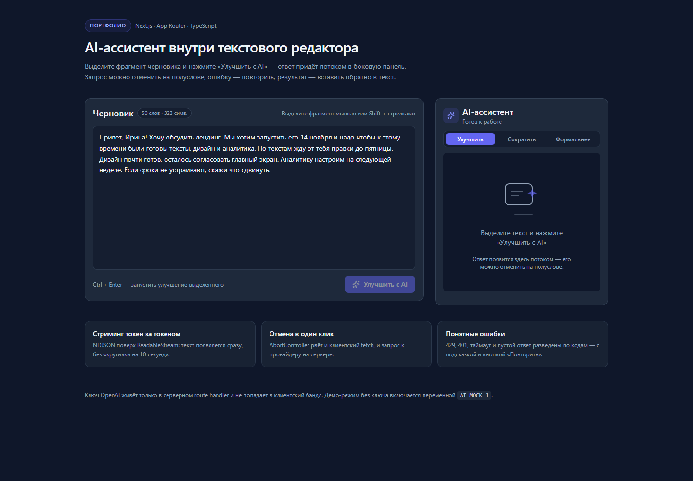
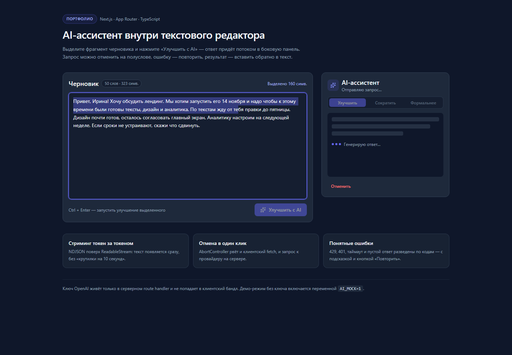
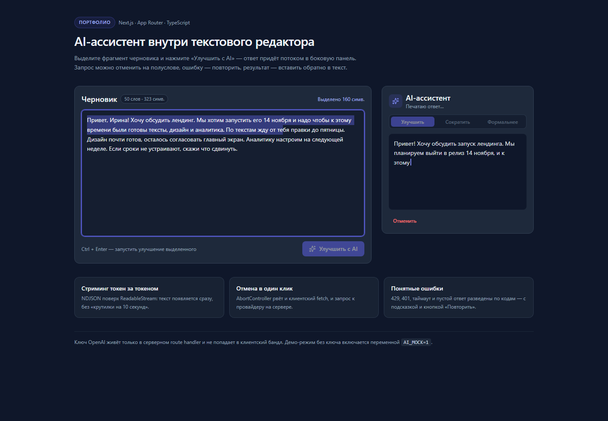
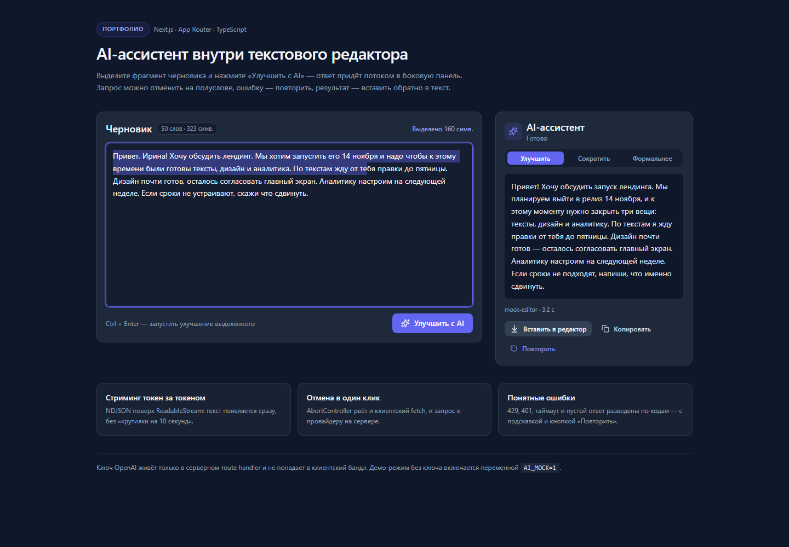
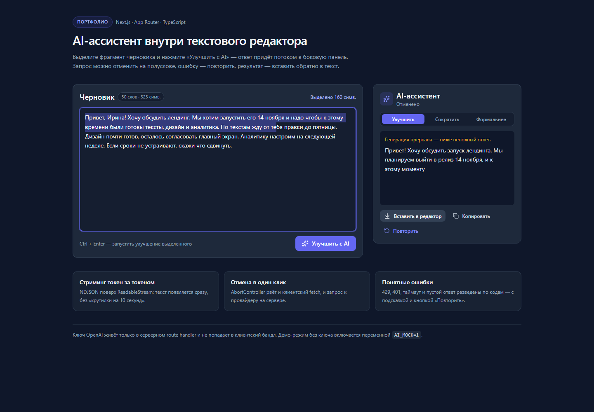
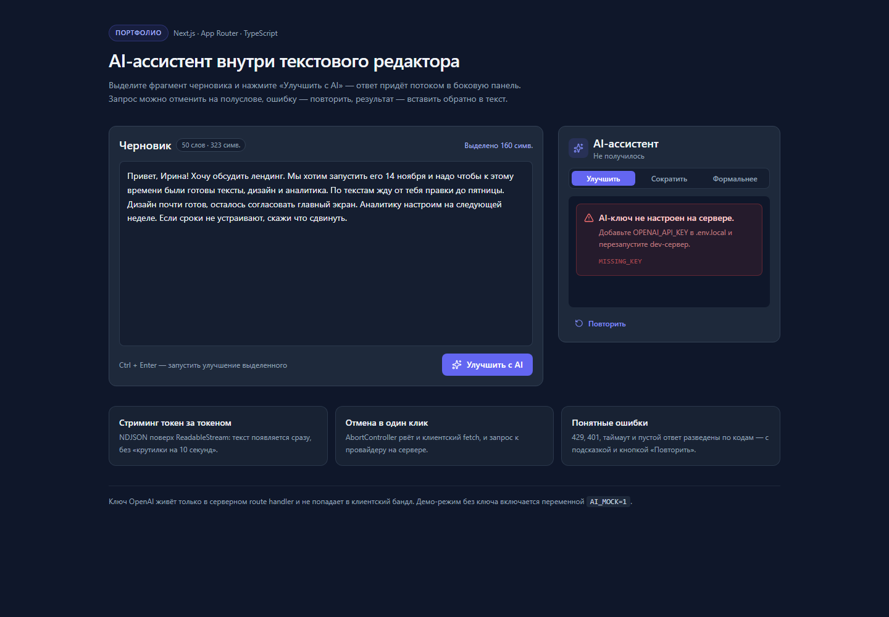
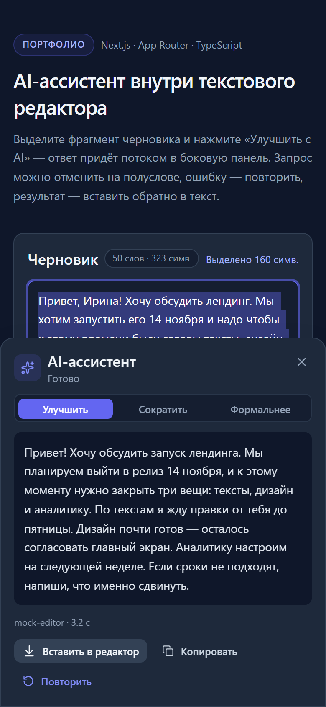

# AI-ассистент внутри текстового редактора

Портфолио-проект: выделяете фрагмент черновика → нажимаете «Улучшить с AI» →
ответ приходит **потоком** в боковую панель, его можно **отменить** на полуслове,
**вставить** обратно в текст или **повторить** после ошибки.

Главная идея — показать не «вызов API», а **UX стриминга**: состояния, восстановление
после ошибок, отмену, доступность и аккуратную типографику.



| Загрузка | Стриминг |
| --- | --- |
|  |  |

| Успех | Отмена |
| --- | --- |
|  |  |

| Ошибка | Мобильный вид |
| --- | --- |
|  |  |

Все скриншоты сняты реальным headless-браузером через CDP
(`scripts/capture-states.mjs`), а не собраны в редакторе.

---

## Стек

- **Next.js 15 (App Router)** — серверный route handler + статическая страница
- **React 19 + TypeScript** — strict, `noUncheckedIndexedAccess`
- **Tailwind CSS 3.4** — дизайн-токены из ТЗ, без UI-кита
- **Zustand 5** — состояние документа и ассистента
- **lucide-react** — иконки
- **zod** — валидация входа на сервере
- **OpenAI `gpt-4o-mini`** — провайдер, ключ только на сервере

Свои компоненты вместо shadcn/ui: нужен был ровно один вариант кнопки и полный
контроль над цветами состояний. Бандл первой загрузки — ~113 kB JS.

---

## Структура проекта

```
ai-editor-assistant/
├─ app/
│  ├─ api/ai/route.ts          # POST: валидация → OpenAI → NDJSON-стрим
│  ├─ error.tsx                # error boundary на случай падения рендера
│  ├─ icon.svg                 # favicon (Next отдаёт его как /icon.svg)
│  ├─ globals.css              # базовые стили, тёмная тема, скроллбар
│  ├─ layout.tsx               # языковой тег, шрифты, метаданные
│  └─ page.tsx                 # серверная страница-композиция
├─ components/
│  ├─ assistant/
│  │  ├─ AssistantPanel.tsx    # панель: шапка, состояния, действия
│  │  ├─ EmptyState.tsx        # иллюстрация + подсказка
│  │  ├─ ErrorState.tsx        # блок ошибки (role="alert")
│  │  ├─ LoadingState.tsx      # скелетон + три точки
│  │  ├─ ModeSelector.tsx      # «Улучшить / Сократить / Формальнее»
│  │  └─ StreamingText.tsx     # текст + мигающий курсор
│  ├─ editor/EditorCard.tsx    # textarea, выделение, Ctrl+Enter
│  ├─ ui/Button.tsx            # варианты кнопок, disabled/loading
│  └─ workspace.tsx            # связка редактора и панели
├─ lib/
│  ├─ ai/
│  │  ├─ mock.ts               # демо-поток без ключа (AI_MOCK=1)
│  │  ├─ openai.ts             # прокси SSE OpenAI → onDelta
│  │  └─ prompt.ts             # системный промпт, режимы, лимит входа
│  ├─ hooks/use-ai-stream.ts   # fetch + getReader + AbortController + таймаут
│  ├─ store/assistant-store.ts # Zustand: документ, выделение, статусы
│  ├─ stream/ndjson.ts         # кодирование/парсинг событий
│  ├─ utils/cn.ts
│  └─ errors.ts                # каталог ошибок: код → сообщение → retryable
├─ types/ai.ts                 # общие типы клиента и сервера
├─ scripts/
│  ├─ verify-stream.mjs        # смоук-тест протокола без Next
│  ├─ e2e-local.mjs            # 16 E2E-проверок через HTTP
│  └─ capture-states.mjs       # скриншоты состояний через CDP
└─ docs/
   ├─ ai-sdk-alternative.md    # вариант на Vercel AI SDK
   ├─ lighthouse.report.html   # отчёт аудита (99/100/100/100)
   └─ screenshots/
```

Корневые конфиги: `next.config.mjs`, `tsconfig.json` (strict), `tailwind.config.ts`,
`postcss.config.mjs`, `eslint.config.mjs` (flat config, `next/core-web-vitals`).

---

## Как это работает

### 1. Клиент → сервер

`useAIStream.run()` берёт выделенный фрагмент из Zustand, поднимает `AbortController`
и делает `fetch("/api/ai", { signal })`. Таймаут 45 с — через `setTimeout` → `abort()`,
причём причина отмены запоминается в `abortReasonRef`, чтобы отличить **таймаут**
(ошибка + «Повторить») от **осознанной отмены** (состояние `aborted`).

### 2. Сервер

`app/api/ai/route.ts`:

1. валидирует JSON через zod (длина ≤ `AI_MAX_INPUT_CHARS`, режим из enum);
2. читает `OPENAI_API_KEY` **только** из `process.env` — в бандл клиента ключ не попадает;
3. открывает `ReadableStream` и вызывает `streamChatCompletion`;
4. парсит SSE провайдера построчно и превращает каждый `delta.content` в событие;
5. отдаёт `application/x-ndjson` с `Cache-Control: no-store, no-transform`
   и `X-Accel-Buffering: no` (иначе прокси буферизует и стриминг «залипает»).

### 3. Протокол

Одна строка = один JSON:

```json
{"type":"delta","text":"Привет"}
{"type":"delta","text":", "}
{"type":"error","error":{"code":"rate_limit","message":"…","retryable":true}}
{"type":"done","meta":{"model":"gpt-4o-mini","durationMs":1840,"completionTokens":142}}
```

Почему NDJSON, а не «сырой текст»: ошибка может случиться **после** старта потока
(429 посреди ответа, обрыв) — её нужно передать типизированным событием.
Почему не SSE: `getReader()` + построчный парсер проще и не требует префиксов `data:`.

Клиент буферизует чанки и режет по `\n`, поэтому строка может быть разрезана
сетью на любом байте — `createEventParser` это переживает.

### 4. Состояния

```
idle ──run()──► loading ──первый delta──► streaming ──done──► success
                   │                          │
                   ├──ошибка──► error ◄────────┘ (error-событие в потоке)
                   └──cancel()──► aborted  (частичный текст сохраняется)
```

| Состояние | Что видит пользователь | Классы |
| --- | --- | --- |
| `idle` | SVG-иллюстрация + «Выделите текст и нажмите “Улучшить с AI”» | `text-slate-500 text-sm text-center` |
| `loading` | скелетон из 3 полос + три пульсирующие точки + «Генерирую ответ…» | `animate-pulse bg-slate-700/60`, `bg-indigo-500 animate-dots-bounce`, `text-xs text-slate-400` |
| `streaming` | текст появляется по токенам, в конце мигающая палочка | `whitespace-pre-wrap text-slate-200`, `w-0.5 h-4 bg-indigo-400 animate-caret-blink` |
| `success` | тот же текст без курсора + метаданные модели + «Вставить / Копировать / Повторить» | `bg-slate-700 hover:bg-slate-600 text-slate-100`, `text-indigo-400 hover:text-indigo-300` |
| `error` | красный блок с иконкой, сообщением, подсказкой и кодом | `bg-red-500/10 border border-red-500/30 text-red-300 rounded-lg p-3 text-sm` |
| `aborted` | «Генерация прервана — ниже неполный ответ» + частичный текст | `text-xs text-amber-400/90` |

Кнопка запуска: `bg-indigo-500 hover:bg-indigo-400 text-white rounded-lg px-4 py-2
text-sm font-medium` + `disabled:opacity-50 disabled:cursor-not-allowed`.

### 5. Ошибки

Каталог в `lib/errors.ts`: код → сообщение → подсказка → `retryable`.

| Код | HTTP | Что говорит интерфейс |
| --- | --- | --- |
| `missing_key` | 500 | «AI-ключ не настроен на сервере» + как исправить |
| `unauthorized` | 401/403 | «OpenAI отклонил запрос: неверный или отозванный ключ» |
| `rate_limit` | 429 | «Слишком много запросов» + «Подождите 10–20 секунд» |
| `payload_too_large` | 413 | «Фрагмент длиннее 6000 символов (N)» |
| `bad_request` | 400/422 | «Выделенный текст пустой или некорректный» |
| `timeout` | — | «Модель не ответила за 45 секунд» |
| `empty_response` | — | «Модель вернула пустой ответ» |
| `network` | — | «Не удалось соединиться с сервером» |

`retryable` управляет кнопкой «Повторить»: при `unauthorized` её нет — повтор
без исправления ключа бессмысленен.

---

## UX-решения (что и почему)

1. **Текст появляется сразу, а не по завершении.** Time-to-first-token ~0.7–1 с
   против 3–8 с ожидания целого ответа: пользователь видит прогресс и решает,
   читать дальше или отменить. В mock-режиме пауза 700 мс сделана нарочно —
   иначе состояние `loading` мелькает и его невозможно ни увидеть, ни показать.
2. **Скелетон + точки, а не только спиннер.** Скелетон показывает «объём» будущего
   блока и не даёт панели прыгать по высоте; точки подтверждают, что процесс живой.
3. **Отмена сохраняет полученное.** `aborted` не стирает частичный текст — его можно
   вставить (иногда половина ответа уже полезна) или перезапустить.
4. **Отмена ≠ ошибка.** Разные состояния, разные цвета: `aborted` — янтарная пометка,
   `error` — красный блок. Пользователь не пугается того, что сделал сам.
5. **Ошибка объясняет, что делать.** Три уровня: что случилось → что сделать →
   технический код (`RATE_LIMIT · HTTP 429`) для отладки.
6. **Режим — сегментированный контрол, а не select.** Три частых сценария видны
   сразу, переключение в один клик; на мобильных занимает одну строку.
7. **Вставка возвращает фокус в редактор** и ставит каретку после вставленного
   фрагмента — не нужно искать место мышью.
8. **Горячие клавиши:** `Ctrl+Enter` — запуск, `Esc` — отмена.
9. **Мобильная шторка** вместо переключения экранов: редактор остаётся видимым,
   панель выезжает снизу на 82vh, учитывает `env(safe-area-inset-bottom)`.

## Доступность

- Область ответа: `role="log" aria-live="polite" aria-atomic="false"` — скринридер
  дочитывает **дополнения**, а не весь текст заново на каждом токене.
- `aria-busy` на области во время `loading`/`streaming`.
- Завершение анонсируется один раз через скрытый `aria-live="polite"`:
  «Ответ готов. N символов».
- Ошибка: `role="alert" tabIndex={-1}` + перевод фокуса на блок — сообщение
  зачитывается сразу, а кнопка «Повторить» рядом.
- Все интерактивные элементы имеют `focus-visible:ring-2 ring-indigo-400`.
- Мигающий курсор и пульсация отключаются при `prefers-reduced-motion`
  (`motion-reduce:animate-none`).
- **Контраст проверен axe в составе Lighthouse, а не «на глаз».** Вторичный текст
  из ТЗ (`text-slate-500`) давал 3.07:1 на `slate-800` и 3.75:1 на `slate-900` —
  ниже AA (нужно 4.5:1), поэтому он заменён на `text-slate-400` (5.7:1 и 7.0:1).
  Мобильная кнопка-триггер переведена с `indigo-500` на `indigo-600` (4.46 → 6.3:1).
- Основная CTA оставлена `#6366F1` из ТЗ: белый текст на нём даёт 4.46:1 — на
  сотые ниже AA. Если нужен строгий AA, замените `bg-indigo-500` на `bg-indigo-600`
  в `components/ui/Button.tsx` — это одна строка, внешне почти не отличимо.
- `aria-label` у textarea, `aria-labelledby` у секций, радиогруппа режимов
  с `role="radio"` и поддержкой стрелок.

## Безопасность

- `OPENAI_API_KEY` читается только в `app/api/ai/route.ts`; в клиентском бандле
  его нет (проверяется E2E-тестом на утечку `sk-…`).
- Вход ограничен по длине и провалидирован zod — нельзя отправить 100 КБ текста.
- Наружу уходят только коды ошибок и русские сообщения, без стектрейсов и тел
  ответов провайдера.
- `Cache-Control: no-store` — ответы не попадают в кеш CDN.

---

## Локальный запуск (Windows, PowerShell)

```powershell
# 1. Зависимости
cd ai-editor-assistant
npm install

# 2. Переменные окружения
Copy-Item .env.local.example .env.local
# откройте .env.local и вставьте ключ:
#   OPENAI_API_KEY=sk-...

# 3. Дев-сервер
npm run dev
# → http://localhost:3000
```

**Демо без ключа.** Если ключа нет, поставьте в `.env.local`:

```
AI_MOCK=1
```

Сервер отдаст заранее заготовленный текст настоящим потоком (с той же задержкой
и отменой) — удобно для проверки UI и для публичного демо.

Проверка качества:

```powershell
npm run lint          # eslint . (next/core-web-vitals + next/typescript)
npm run typecheck     # tsc --noEmit
npm run build         # production-сборка
npm run verify:stream # смоук-тест протокола, без сети и Next
npm run e2e           # 16 HTTP-проверок (нужен запущенный сервер)
```

Что прогонялось на этой копии и с каким результатом:

| Команда | Результат |
| --- | --- |
| `npm run lint` | 0 ошибок, 0 предупреждений |
| `npm run typecheck` | 0 ошибок (strict + `noUncheckedIndexedAccess`) |
| `npm run build` | успешно, First Load JS 113 kB, `/` статический, `/api/ai` динамический |
| `npm run verify:stream` | TTFT 703 мс, 107 дельт, отмена оставляет 115 символов |
| `npm run e2e` | 16/16: TTFB 720 мс, полный ответ 3.2 с, 400/413/500, обрыв через `AbortController` |

### Lighthouse

Отчёт: [`docs/lighthouse.report.html`](docs/lighthouse.report.html) (снят с прод-сборки).

| Категория | Оценка |
| --- | --- |
| Performance | **99** |
| Accessibility | **100** |
| Best Practices | **100** |
| SEO | **100** |

Метрики: FCP 0.8 с, LCP 0.8 с, TBT 130 мс, CLS 0. Проваленных аудитов — нет.
Из отчёта исправлено два реальных замечания: 404 на `/favicon.ico` (добавлен
`app/icon.svg`) и контраст вторичного текста (см. раздел «Доступность»).

Скриншоты состояний (нужен headless Edge/Chrome):

```powershell
npm run start -- --port 3101
& "C:\Program Files (x86)\Microsoft\Edge\Application\msedge.exe" `
  --headless=new --remote-debugging-port=9222 --user-data-dir=.edge-profile about:blank
$env:BASE_URL = "http://127.0.0.1:3101"
# состояние ошибки снимается со второго сервера, запущенного без ключа:
$env:AI_MOCK = "0"; npm run start -- --port 3102
$env:ERROR_BASE = "http://127.0.0.1:3102"
node scripts/capture-states.mjs
```

## Деплой на Vercel

1. Запушьте репозиторий на GitHub (`.env.local` в `.gitignore` — ключ не утечёт).
2. [vercel.com/new](https://vercel.com/new) → **Import Git Repository**.
3. Framework Preset определится как **Next.js**; команды менять не нужно
   (`npm run build`, output — авто).
4. **Settings → Environment Variables** → добавьте `OPENAI_API_KEY`
   (Production + Preview). Для демо-режима — `AI_MOCK=1` вместо ключа.
5. **Deploy**. Route handler работает на Node-рантайме, стриминг на Vercel
   поддерживается из коробки; `maxDuration = 60` ограничивает время функции.
6. Передеплой после смены переменных: **Deployments → Redeploy**.

> Локально проверяйте прод-сборку через `npm run build && npm run start`,
> а не только `npm run dev`: dev-режим прощает то, что ломает прод (например,
> кеширование ответа route handler).

---

## Чек-лист «что показать работодателю»

- [x] **Скриншоты всех состояний** — `docs/screenshots/01–07` (idle, loading,
      streaming, success, aborted, mobile, error).
- [x] **Живое демо** на Vercel в режиме `AI_MOCK=1` (без ключа и без затрат).
- [x] **README с UX-решениями** — раздел выше: почему скелетон, почему отмена
      не стирает текст, почему ошибка трёхуровневая.
- [x] **Стриминг видно глазами**: в демо откройте DevTools → Network → `ai` →
      Response, включите «EventStream»/chunked и покажите, как строки приходят по одной.
- [x] **Lighthouse** — 99 / 100 / 100 / 100 на прод-сборке, отчёт в `docs/lighthouse.report.html`.
      После деплоя прогоните ещё раз на публичном URL — цифры зависят от сети.
- [ ] **Видео 20–30 сек**: выделение → стриминг → отмена → повтор → вставка.
- [x] **Разбор одного бага** — «почему E2E показывал TTFB = 0 мс» (раздел выше).
- [x] **Ссылка на `docs/ai-sdk-alternative.md`** — показывает, что выбор
      «ручного» стрима осознанный, а не от незнания SDK.

## Разбор бага: почему E2E показывал TTFB = 0 мс

Одна из проверок стриминга утверждала «первый чанк приходит быстрее полного
ответа» и всегда показывала `TTFB=0ms`. Выглядело как победа, а было ошибкой
измерения.

**Причина.** `performance.now()` брался после `await fetch(...)`. Но `fetch`
резолвится не когда сервер вернул заголовки, а когда пришёл **первый байт тела**
(в Node/undici — так же, как в браузере). То есть к моменту старта замера
700 мс ожидания уже прошли, и «время до первого байта» честно равнялось нулю.
Заодно «полное время» не включало паузу перед первым токеном — цифры занижались.

**Как нашли.** Отдельный пробник печатал время каждого чанка от старта запроса:

```
headers at 790 ms
chunk 0 at 793 ms, bytes= 40  {"type":"delta","text":"Привет!"}
```

Стало видно, что `fetch` ждал 790 мс, а не 0.

**Исправление.** Отсчёт перенесён на момент до вызова `fetch`:

```js
const requestStartedAt = performance.now();
const response = await post({ text: TEXT, mode: "improve" });
const { events, firstChunkAt } = await readStream(response, requestStartedAt);
```

Проверка начала показывать правду: `TTFB=720ms, всего=3223ms`.

**Вывод для интервью.** Метрика, которая всегда идеальна, обычно измеряет не то,
что кажется. TTFB стриминга надо считать от старта запроса, а не от `Response`.

## Известные ограничения

- Вставка результата делает `slice` строки: нативный undo в textarea после
  программной вставки сбрасывается. Для MVP приемлемо; в проде — TipTap с
  `insertContentAt` и историей.
- Редактор — `textarea`, поэтому нет форматирования и изображений. Выбор осознанный:
  выделение через `selectionStart/selectionEnd` даёт нативный UX (Shift+стрелки,
  двойной клик, drag) без борьбы с contenteditable-кареткой.
- Токены не считаются на клиенте: `completionTokens` приходят только от OpenAI
  (`stream_options.include_usage`), в mock-режиме их нет.
- Нет истории запросов: панель показывает только последний ответ.
